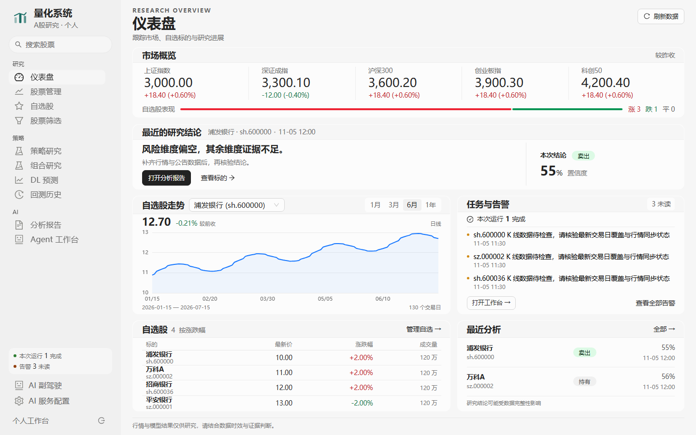
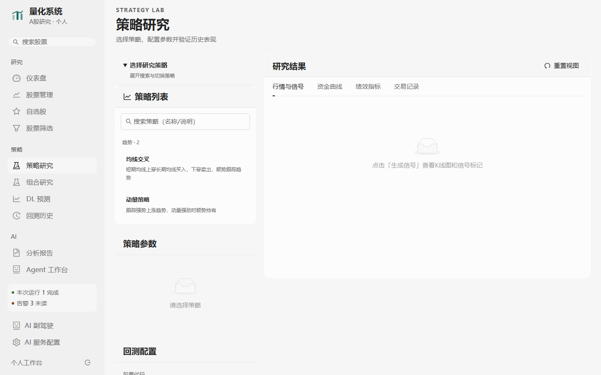
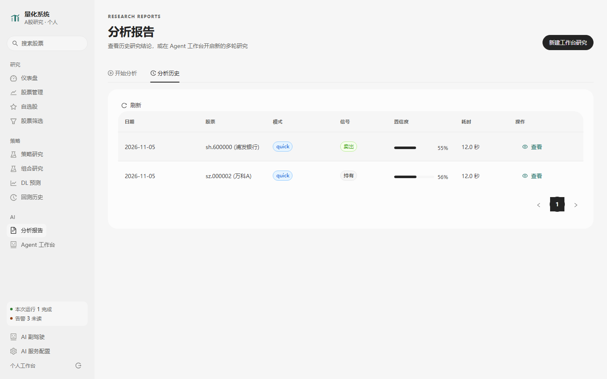

# Backing 产品体验诊断

日期：2026-11-14

## 判断

当前最明显的体验缺口，是一次研究在多个页面之间缺乏连续性：用户需要自己决定入口、记住标的与参数、寻找刚才的结果，并判断下一步行动。

这份诊断建议先修复能复现的操作断点，再梳理研究流程与界面层级。以下建议尚未实施。

## 检查方式与范围

- 阅读导航、仪表盘、个股详情、策略研究、回测历史、股票筛选、自选、组合研究、分析报告、Agent 工作台、副驾驶、DL 实验及相关状态管理代码。
- 使用 gstack 浏览本地 Vite 页面。
- 浏览器内复用仓库现有 `frontend/e2e/fixtures/dashboard.ts`、`research.ts` 夹具，替换当前浏览器内 Axios adapter。没有更改应用源码或后端认证。
- 实际检查仪表盘到报告、个股到策略研究、切换股票、回测后展示、离开并返回策略页等操作。
- 回测操作使用测试响应；本轮没有启动后端，没有访问真实模型、数据提供商或执行模拟订单。
- 本轮属于产品与操作体验诊断，没有运行全仓测试、性能基准、投资研究有效性评估或完整安全审计。

## 应先处理的问题

### 1. 从个股进入策略页后，股票选择被入口 URL 覆盖

优先级：P1。证据：浏览器复现、对照检查、源码定位。

复现：

1. 仪表盘打开浦发银行。
2. 个股详情点击“进入策略验证”。
3. URL 为 `/strategies?stock=sh.600000`。
4. 股票搜索输入“万科”，选择“sz.000002 - 万科A”。
5. 表单立即回到 `sh.600000`，`backing_strategies_stockCode` 也回到 `"sh.600000"`。

对照：从侧栏打开无 `stock` 参数的 `/strategies`，同样选择万科 A，表单和存储保持 `sz.000002`。

根因：`Strategies.tsx:100` 的 effect 同时依赖 `requestedStock` 和 `stockCode`。当用户修改表单，effect 再次把固定的 URL 参数写回表单。

建议：明确 URL、表单和持久状态的更新规则。入口标的用于初始化或实际 URL 变更；后续用户选择应被保留，必要时同步 URL。

### 2. 点击具体报告或告警，只进入通用页面

优先级：P1。证据：报告入口浏览器复现；其他入口源码确认。

- 仪表盘“打开分析报告”进入 `/agent`，默认显示历史列表，没有直接打开这次报告。
- 最近分析中的不同记录都调用 `navigate('/agent')`，没有携带记录 ID。
- 仪表盘告警、侧栏任务统计与告警统计都进入 `/workspace`。
- 工作台默认研究页签是 `market`，通用告警链接没有请求打开告警页签。

用户影响：点过的记录需要再找一次；任务失败数量可见，但不能由统计直接追溯具体失败任务。

位置：

- `frontend/src/pages/Dashboard.tsx:529`
- `frontend/src/pages/Dashboard.tsx:664`
- `frontend/src/pages/Dashboard.tsx:807`
- `frontend/src/App.tsx:309`
- `frontend/src/pages/AgentAnalysis.tsx:79`
- `frontend/src/pages/AgentWorkspace.tsx:140`

建议：记录、任务、告警和页签使用可直接定位的链接；点击结果应打开对应对象。

### 3. 策略页保留部分输入，却不恢复刚做出的结果

优先级：P1。证据：浏览器复现与源码确认。

复现：选择策略和股票，用测试响应执行回测，看到“已保存结果 #41”；进入回测历史，再从侧栏返回策略研究。

结果：股票仍保留，但已保存结果提示消失，资金曲线、绩效指标和交易记录页签重新禁用。

这不表示后端历史记录被删除。问题是当前工作现场没有恢复，用户被迫去历史记录重新寻找。

此外，策略参数使用普通 `useState`，重挂载后会按策略默认值初始化；股票、区间、资金则使用 sessionStorage。不同输入的保留规则不一致。

位置：`frontend/src/pages/Strategies.tsx:114`、`:127`、`:140`。

已有可复用基础：

- 回测历史支持 `?result=<id>` 定位详情，筛选与页码也放在 URL 中。
- DL 实验保存 job ID 和请求，支持返回页面后重新观察任务。
- Agent 会话可通过 `thread_id` 恢复。

建议：为策略页定义当前实验的身份、参数草稿和已保存结果恢复规则，保证返回页面时能继续工作。

### 4. 多个 AI 入口需要用户理解内部模块边界

优先级：P2。证据：导航、组件和会话实现。

当前可见入口包括“分析报告”“Agent 工作台”“AI 副驾驶”。报告页同时保留“开始分析”功能，工作台也可发起研究；副驾驶可打开完整工作台。

这些入口确有不同实现与用途，但界面对“我现在应该用哪个”的解释不足。

补充限制：副驾驶只提供 route/entity 上下文。策略页上的股票、参数、回测记录等没有作为完整研究上下文传入。副驾驶中的“打开完整工作台”只导航 `/workspace`；能否承接当前会话，依赖当前地址已有的 `thread_id`，没有明确的目标链接契约。

位置：

- `frontend/src/App.tsx:62`
- `frontend/src/App.tsx:585`
- `frontend/src/components/research/ResearchCopilot.tsx:68`
- `frontend/src/hooks/useAgentChat.ts:75`

建议：给用户一个明确的研究主入口；区分发起研究、继续当前研究、查看已保存报告。侧边副驾驶应能解释当前页面的具体实验。

### 5. 首次使用策略页，用户需要自行安排执行顺序

优先级：P2。证据：浏览器与源码。

首次进入未选策略的页面时，左侧依次展示策略目录、参数空状态与回测配置；右侧大面积显示结果空状态。1440×900 窗口下，主要执行按钮在首屏下方。

补数据、生成信号、执行回测、参数优化和全策略对比集中在配置区，其中生成信号与执行回测都是主按钮。

执行回测完成后，当前结果页签仍为“行情与信号”，用户还要主动选择资金曲线或绩效指标。

位置：`frontend/src/components/strategies/StrategyConfig.tsx:287`、`frontend/src/components/strategies/StrategyResults.tsx:207`。

建议：以一条默认路径组织首次操作，显示当前条件是否满足、主要动作是什么、完成后该看什么；将优化、批量比较和执行假设作为进阶操作。

### 6. 已有后台任务能力，前台缺少统一的任务入口与恢复方式

优先级：P2。证据：状态与页面代码。

- 侧栏主要显示本次后端运行期间的完成与失败计数。
- 策略参数优化使用页内 loading 和轮询；当前 job ID 没有作为跨页恢复入口保存。
- 传统分析页的 job ID 与运行状态保存在页面内；离开页面会停止当前轮询，返回后没有该页的自动恢复链路。
- DL 实验具有更完整的恢复与取消处理。

离开页面停止轮询不等于后台任务取消，但用户很难在界面上明确区分两者。

位置：`frontend/src/hooks/useSystemStatus.ts:5`、`frontend/src/pages/Strategies.tsx:298`、`frontend/src/pages/AgentAnalysis.tsx:84`、`frontend/src/hooks/useDLExperiment.ts:84`。

建议：统一显示排队、运行、完成、失败、取消；提供返回结果、失败原因、重试和取消入口，支持切页后找到正在执行的工作。

## 进一步的产品优化方向

### 7. 结果需要帮助用户解释下一步

优先级：P2。证据：策略结果与历史详情代码；属于产品建议。

策略结果提供收益、回撤、夏普、胜率、交易次数等原始指标，但缺少集中解释“这次验证支持什么、哪些证据不足、下一步验证什么”的摘要。

建议由确定性计算和明确规则组织摘要，例如与买入持有基准的对照、成本影响、交易样本数量、数据覆盖和样本外验证状态。不以模型置信度代替策略正确率，也不自动宣称策略有效。

组合研究已经具有基准比较能力，可在产品层面统一解释方式；是否能将同样的数据契约用于单股策略，还需要后续设计。

### 8. 自选、报告、实验之间缺少稳定的研究归档方式

优先级：P2。证据：已检查页面的职责与状态边界；属于产品建议。

当前历史分别存在于回测、DL、选股和 AI 会话中。自选股主要管理代码与行情，缺少一个能集中看到“为什么关注、验证过什么、还有什么待核对”的位置。

建议先做轻量研究记录关联：围绕标的保存研究问题、关联报告和实验、下一步事项。是否需要专门的研究项目实体，应等主流程明确后决定。

### 9. 页面密度与组件规则需要统一

优先级：P3。证据：截图、样式和主题配置。

- 仪表盘按整个视口高度分配区块，并使用随高度变化的字体和间距。
- 策略页左栏长表单与右侧大结果区域并列，首次操作需要明显滚动。
- 报告页使用另一套布局与组件主题；App 对研究组和策略组启用的主题不涵盖 AI 组。
- DL 页有独立的 ConfigProvider token 配置。
- 登录页保留多项禁用入口，以及较多认证实现术语；对个人研究用户的主要任务帮助有限。

建议统一正文与辅助字号、表格行高、按钮语义、内容宽度、页内滚动、空状态和错误恢复；保留图表分析所需空间，让高频操作稳定可见。

位置：`frontend/src/styles/dashboard.css:4`、`frontend/src/App.tsx:364`、`frontend/src/pages/DLPrediction.tsx:217`、`frontend/src/pages/Login.tsx:232`。

## 推荐顺序

1. 修操作断点：股票选择覆盖、报告与告警定位、实验状态恢复。
2. 梳理单股研究主流程：明确入口、保留研究上下文、降低首次配置负担。
3. 统一任务反馈与结果解释：让用户知道工作进展、证据边界和下一步。
4. 统一交互与视觉规则，再决定需要增加哪些研究管理功能。

第一轮验收可围绕一个具体场景：从自选打开股票，发起研究，进入策略验证，切换标的，运行回测，离开查看历史，再返回继续；每一步应保留正确的标的与实验上下文，点击记录应直达对应内容。

这是一组待讨论的优化建议，不是已批准的实施设计。本轮没有修改业务代码、提交或部署。

## 页面证据

仪表盘（测试数据）：

策略页首次进入（测试数据）：

分析报告列表（由仪表盘“打开分析报告”进入，测试数据）：

