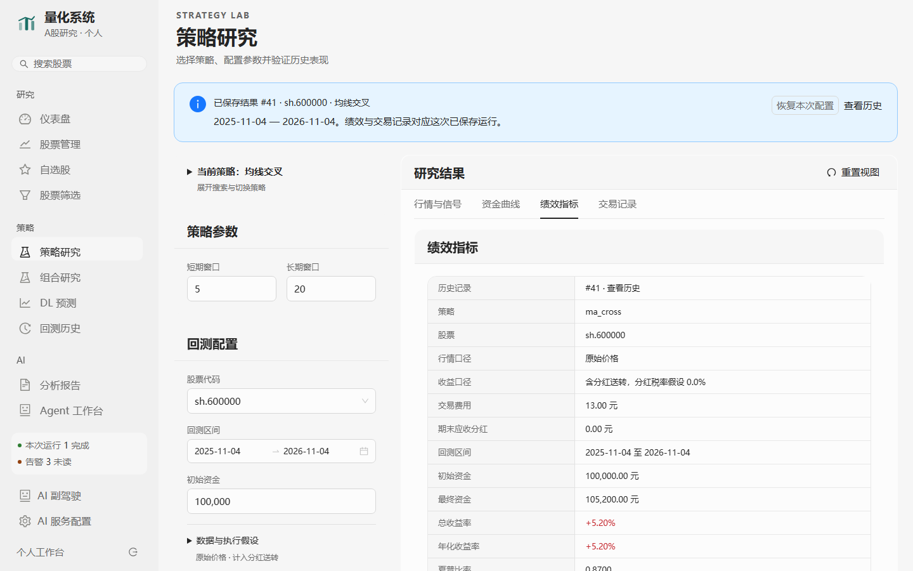
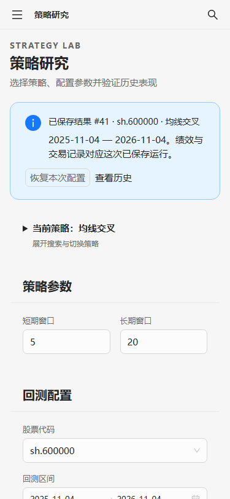

# 单股研究连续性优化：实施与验证

日期：2026-11-14

## 已实现

- 策略页入口标的、表单和 URL 保持一致；用户后续改选不再被入口值覆盖，支持清空。
- 策略参数按策略分别保存，切换策略、目录后台刷新、切页或刷新后恢复。
- 最近一次回测响应与原请求一起保存，返回页面恢复结果和页签，不自动重新提交回测。
- 回测成功优先展示绩效，生成信号后回到行情页签；既有回测仍可查看。
- 比较当前完整请求与已保存请求，包含价格口径、分红假设和参数；配置变化时明确提示，并提供“恢复本次配置”和“查看历史”。
- 新股票或区间尚未加载时卸载旧行情图，避免 ECharts 合并旧 series 导致误显示。
- 无效策略配置草稿回退到默认值，异常保存结果被忽略。
- 仪表盘最近报告直达 `/agent?report=<id>`；支持 URL 刷新、关闭、后退、失败重试和异步切换防串报告。
- 手机端恢复按钮换行，不挤压提示正文。

## 验证记录

| 检查 | 结果 |
| --- | --- |
| TypeScript typecheck | 通过 |
| ESLint | 通过，无错误或警告 |
| 全量 Vitest | 43 文件，230 测试通过 |
| 生产构建及分包预算 | 通过，全部 chunk 预算通过；Vite 保留未压缩大包提醒 |
| 全仓 format:check | 通过 |
| 本轮所有修改文件格式检查 | 通过 |
| 相关工作流浏览器回归 | 17/17 通过，含 10 项新增流程测试 |
| 全量 Playwright 最后一次整轮 | 91/92 通过；失败为既有 DL 布局测试的资源加载错误 |
| DL 失败项单独复跑 | 1/1 通过，2.6 秒 |
| 桌面与手机实看 | gstack，1440×900 和 375×812；无横向溢出 |
| 独立代码审查 | 发现两项重要问题，均补失败回归并修复：旧 K 线残留、异常表单草稿 |

全量浏览器运行中的 DL 布局测试 `the reference layout fills the desktop and navigation stays separate from bottom utilities` 在查找 `.dl-config-panel` 时超时。Trace 控制台显示路由依赖 `react-router-dom.js` 加载发生 `net::ERR_NO_BUFFER_SPACE`，截图为白屏；单独复跑通过。保留整轮的失败记录，不将其表述为单次 92/92 全绿。

首轮并行浏览器运行的三项失败中，已有研究流程暴露出保存结果的日期校验过严；已允许返回的有效交易日期与原请求区间分别保留并补单测。新测试的下拉操作改为键盘选择。修正后的相关流程全部通过。

## 实现选择与边界

- 直接在已有功能分支中修改限定的前端文件，保留原有后端、部署和其他工作；未提交、推送或部署。
- 草稿和最近结果存于当前标签页 sessionStorage，长期历史仍在数据库；不承诺跨标签页、跨设备或关闭标签页后的恢复，浏览器容量不足时只能保留当前页面内存态。
- 采用原始响应和请求快照，避免从旧详情 API 推断不完整的执行元数据；恢复使用原始请求区间，展示保留响应区间。
- 共享组件只增加可选的清空与校验参数，原有调用默认行为保持兼容。
- 本轮浏览器操作使用仓库现有确定性夹具，未启动后端或访问真实模型、行情供应商、模拟订单接口。
- 临时前端预览已停止。

## 视觉证据

桌面完成回测后直接显示绩效：

手机端结果说明与恢复操作：

