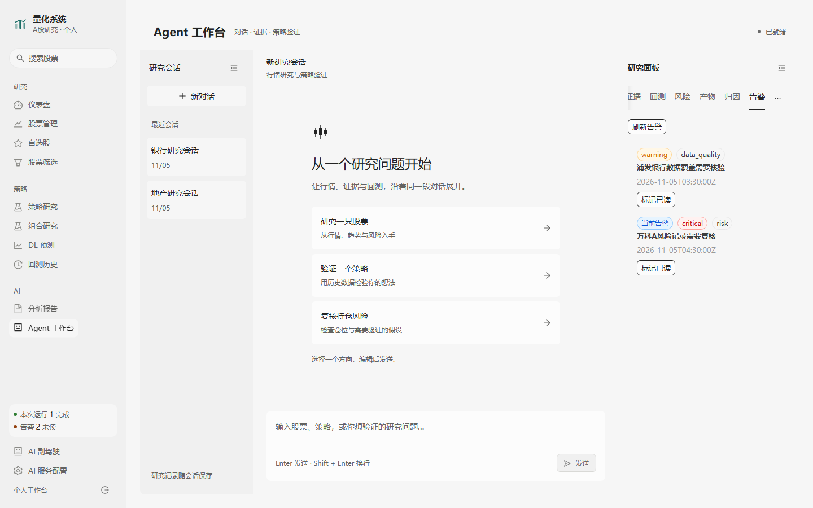
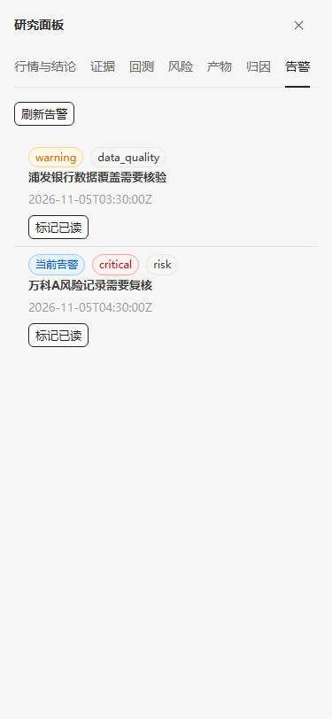

# 第二轮：研究入口与告警定位

日期：2026-11-14

## 已实现

- 从副驾驶打开完整工作台时，显式传递当前会话与合法股票；没有会话时只传股票，不自动创建会话或发送分析。
- 全局副驾驶识别个股路由和页面 `stock` 查询参数，沿用既有 PageContext 字段。
- 工作台研究页签改用 `panel` URL 参数，支持刷新、前进后退，并保留会话、股票及其他参数。
- 仪表盘告警记录直接打开告警面板并定位当前记录；全部告警和侧栏未读告警也直接进入告警面板。
- 显式面板入口可展开桌面研究区或打开手机/平板抽屉；用户关闭后，后台会话恢复与切换不会再次强制打开。
- 告警加载失败与空列表区分；刷新失败保留已有数据，支持重试。标记已读成功后才更新记录和全局计数；失败保留未读并允许重试。
- 正确处理当前工作台内切换会话、迟到响应和返回空会话，保留调用方导航状态。
- 告警操作移到正文下一行；1440px 桌面的消息可用宽度从 132px 增至 256px，375px 手机无横向溢出。

## 验证记录

| 检查 | 结果 |
| --- | --- |
| 第二轮开始前基线 | 43 文件，230 单元/组件测试通过 |
| 最终全量 Vitest | 44 文件，257 测试通过 |
| TypeScript / ESLint | 通过，无错误或警告 |
| 全前端 format:check / diff --check | 通过 |
| 最终生产构建 / chunk 预算 | 通过；Vite 保留大包提醒，所有独立预算通过 |
| 初次相关浏览器回归 | 31/31 通过，含初始 8 项新增流程 |
| 审查修复回归 | 3/3 通过：桌面/手机延迟恢复、调用方导航状态 |
| 最终全量 Playwright | 103/103 通过，单次完整运行 3.5 分钟，包含全部 11 项本轮新增流程 |
| gstack 实看 | 1440×900、375×812，定位/抽屉/已读失败重试和计数同步 |

测试先观察失败，再实现或修复。最初副驾驶测试夹具使用了错误的提交响应包裹，先纠正为真实 `{turn: ...}` 契约，再确认旧代码的股票上下文断言失败。会话路由额外覆盖 StrictMode 重复挂载和旧响应晚到。

## 独立审查与修复

独立只读审查针对第二轮开始前的文件快照生成 diff，避免混入首轮与用户其他未提交工作。

- 重要问题：慢会话恢复会替换 URL，原来每次 location.key 变化都展开面板，导致用户关闭后再次被打开。桌面和手机均新增失败回归，现区分后台 REPLACE 同步与显式入口/浏览器历史。
- 导航状态问题：工作台查询参数更新未保留 location.state；实际浏览器回归进一步发现既有 useAgentRun.detach 的原生 URL 写入也清空 state。两个写入路径均保留状态，回归通过。
- 无拒绝判断的范围内行为，无遗留未处理的审查项。

## 实现取舍与边界

- 范围由实现方根据用户“继续进行第二轮”和先前委托诊断的要求收敛；设计与审查结论不作为用户逐项批准。
- 继续在当前 feature checkout 实现，保留首轮以及原有后端/部署等改动，不提交、推送或部署。以后单独集成时需要选择本轮文件/差异。
- 聊天 hook 增加可选的受控路由接口，保留旧调用方行为；两种初始化路径均覆盖 StrictMode 回归。
- 复用 `['system', 'alerts']` 缓存和现有告警接口，没有新增后端任务中心或历史分页，也没有合并不同 AI 系统。
- 页面上下文仍使用既有 route/entity 字段，本轮不向模型附加策略参数、回测证据或推断数据。
- 交接已保存会话和标的，未发送的输入草稿暂不跨副驾驶和工作台迁移。
- 若指定告警不在当前 API 返回范围中，显示未找到提示并保留当前列表，不声称已搜索全部历史。
- 浏览器测试和实看使用现有仓库确定性夹具，没有启动后端或调用真实模型、行情供应商、模拟订单。
- 为读写行为模拟真实 HTTP，实看 adapter 对夹具响应做 JSON 序列化复制，避免共享可变对象影响 Query 的变更通知。
- 整轮结束后临时前端预览已停止，启动配置已移除，5174 端口已确认空闲；执行快照与日志保留在 gitignored 本轮工作目录，代码仍未提交。
- gstack 的 stop 命令退出时报服务连接丢失/崩溃；随后按 gstack browse 命令行范围检查，未发现残留的 bun/node/browse 守护进程。该工具退出异常不影响已完成的截图、验证或前端服务停止结果。

## 视觉证据

桌面告警记录与独立操作行：

手机端直接打开告警抽屉：

